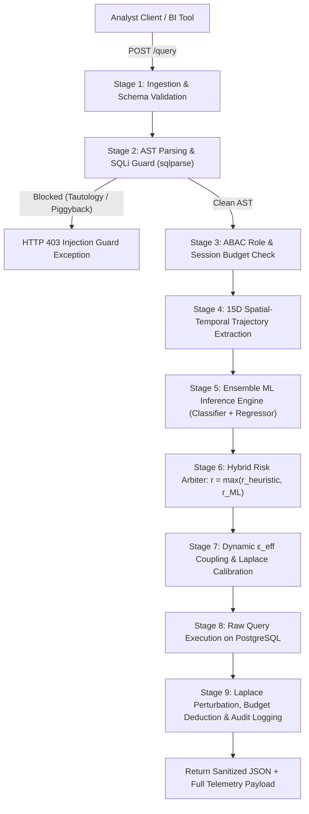

# AP3 — Master Project Documentation & Technical Architecture Guide
## *Adaptive Privacy-Preserving Proxy with Spatial-Temporal Query Trajectory Machine Learning & Closed-Loop Differential Privacy*

---

## 1. Executive Summary & Research Motivation

Relational database systems in enterprise environments frequently face privacy compromises when queried by data analysts, business intelligence tools, and third-party researchers. Differential Privacy (DP) offers rigorous mathematical guarantees against identification, yet existing proxy implementations suffer from three critical architectural vulnerabilities:

1. **Static Privacy Allocation ($\varepsilon$ Blindness):** 
   Tools such as Chorus, PINQ, and Diffprivlib allocate fixed privacy budgets ($\varepsilon$) per query or static lifetime session budgets. Because budget consumption is independent of query correlation, an adversary can submit adjacent, progressively narrowing queries to perform linear reconstruction attacks on individual records.

2. **The "Rejection Side-Channel Oracle" Vulnerability:**
   Conventional auditing proxies employ binary threshold firewalls (throwing `HTTP 403 Forbidden` or `HTTP 429 Too Many Requests` when correlation is suspected). **Abrupt query rejection itself leaks private information:** the denial acts as an oracle confirming to the adversary that their restrictive filter has isolated a subpopulation of size $\le 1$.

3. **Inability to Recognize Multi-Query Attack Trajectories:**
   Heuristic rules evaluate queries in isolation or track simple query counts. They fail against:
   - **Successive Triangulation Attacks:** Progressively narrowing WHERE predicates to pinpoint an individual (Dept $\to$ Dept+Role $\to$ Dept+Role+Salary $\to$ Dept+Role+Salary+Age).
   - **Differencing Probes:** Submitting complementary query pairs ($Q_1$ on group $G$ vs. $Q_2$ on $G \setminus \{x\}$) to reveal individual $x$ through the difference between aggregates.
   - **Quasi-Identifier Tracker Attacks:** Exploiting auxiliary demographic attributes across queries to reconstruct sensitive properties.

### The AP3 Solution
**AP3 (Adaptive Privacy-Preserving Proxy)** is a non-intrusive reverse proxy that intercepts relational queries between analytical clients and standard SQL databases (e.g., PostgreSQL). It replaces binary firewalls and static budgets with a **closed-loop risk-adaptive control loop**:
- Extracts a 15-dimensional spatial-temporal trajectory tensor from incoming SQL Abstract Syntax Trees (AST) and session history.
- Evaluates multi-query attack likelihood using a trained ensemble machine learning model ($< 0.5\text{ ms}$ latency).
- Arbitrates between analytical subpopulation bounds and ML predictions via a hybrid arbiter: $r_{\text{final}} = \max(r_{\text{rule}}, r_{\text{ML}})$.
- Dynamically couples live risk to the effective privacy budget $\varepsilon_{\text{eff}}$, modulating Laplace perturbation noise in closed-loop feedback.
- Enforces non-leaking graceful degradation when risk spikes or budgets deplete, clamping to a noise floor rather than throwing errors.

---

## 2. End-to-End System Architecture (The 9-Stage Pipeline)

When an analyst client submits `POST /query` with `{"username": "alice", "sql": "SELECT AVG(salary)..."}`:



### Detailed Pipeline Breakdown:

1. **Stage 1 — Ingestion & Schema Validation (`main.py`):**
   FastAPI parses and validates the JSON payload (`username`, `sql`) against strict Pydantic models.
2. **Stage 2 — AST Parsing & SQL Injection Guard (`core/query_analyzer.py`):**
   Decomposes the query using `sqlparse`. Detects and blocks multi-statement piggyback injections (`SELECT...; DROP TABLE...`) and tautologies (`WHERE 1=1`, `'a'='a'`). Extracts target tables, projected columns, aggregate functions (`COUNT`, `AVG`, `SUM`, `MIN`, `MAX`), and fine-grained `WHERE` predicates (`department='Engineering'`, `age>=30`).
3. **Stage 3 — ABAC Role Verification (`core/abac.py`):**
   Validates user identity and role (`admin`, `researcher`, `guest`). Verifies that only `SELECT` queries are permitted for non-admin analysts and retrieves nominal budget allocations.
4. **Stage 4 — 15D Trajectory Extraction (`core/trajectory_extractor.py`):**
   Retrieves recent query history for the user within a sliding time window (default 3,600s) from SQLite. Transforms the candidate query and historical sequence into a normalized 15-dimensional spatial-temporal trajectory tensor.
5. **Stage 5 — Ensemble ML Inference Engine (`core/ml_risk_model.py`):**
   Executes a trained ensemble model in under $0.5\text{ ms}$, generating an attack pattern classification (`BENIGN`, `TRIANGULATION`, `DIFFERENCING`, `TRACKER`), confidence score, and empirical continuous risk $r_{\text{ML}} \in [0, 1)$.
6. **Stage 6 — Hybrid Risk Arbitration (`core/inference_tracker.py`):**
   Computes the analytical subpopulation overlap lower-bound $r_{\text{heuristic}}$ and arbitrates:
   $$r_{\text{final}} = \max\left(r_{\text{heuristic}}, \, r_{\text{ML}}\right)$$
7. **Stage 7 — Dynamic Privacy Budget Coupling (`core/differential_privacy.py`):**
   Calculates effective epsilon $\varepsilon_{\text{eff}}$ using the non-linear coupling equation and calibrates the Laplace noise parameter:
   $$b = \frac{\Delta f}{\varepsilon_{\text{eff}}}$$
8. **Stage 8 — Raw Database Execution (`db/postgres.py`):**
   Executes the raw SQL statement against PostgreSQL to compute true mathematical aggregates.
9. **Stage 9 — Perturbation, Sequential Audit & Telemetry (`middleware/proxy.py`):**
   Adds noise drawn from $\text{Laplace}(0, b)$ to numeric aggregates. Deducts consumed $\varepsilon_{\text{eff}}$ from the session budget, persists the execution record to SQLite (`db/history_store.py`), and returns sanitized results alongside transparent privacy metrics.

---

## 3. Machine Learning Model Addition: Spatial-Temporal Trajectory Analysis

### 3.1 Why Machine Learning Was Added
In baseline Differential Privacy proxies, query risk is either ignored or calculated using simple pairwise Jaccard set overlap. While pairwise Jaccard detects identical predicates, it suffers from two major limitations:
- **Differencing Attack Blindness:** When an adversary executes $Q_1$ (`WHERE department = 'Engineering'`) and then $Q_2$ (`WHERE department = 'Engineering' AND id != 1002`), the pairwise predicate Jaccard similarity is $0.50$, which heuristic thresholds treat as moderate or low risk. However, this query delta isolates a single employee's salary with near mathematical certainty.
- **Temporal & Velocity Neglect:** Heuristics treat 5 queries submitted over 5 hours the same as 5 queries submitted in 5 seconds. Attackers automate sequential narrowing using automated scripts.

To solve this, AP3 introduces an **explainable ensemble model** trained on spatial-temporal query trajectories.

---

### 3.2 The 15-Dimensional Trajectory Tensor

For any incoming query $q_t$ evaluated against session history $\mathcal{H}_u = [q_1, \dots, q_{t-1}]$ within sliding window $W$, the trajectory extractor computes 15 spatial-temporal features:

| Feature Name | Mathematical Formulation | Security & Attack Detection Rationale |
| :--- | :--- | :--- |
| **`curr_pred_count`** | $|\mathcal{P}_{q_t}|$ | Number of WHERE filters; highly specific queries indicate target isolation. |
| **`time_delta_mean`** | $\frac{1}{k}\sum_{i=1}^k (t_q - t_{q_i})$ | Average elapsed interval in sliding window; distinguishes human vs. script. |
| **`time_delta_min`** | $\min_{i} (t_q - t_{q_i})$ | Minimum inter-query interval; automated probes submit queries in $< 10\text{s}$. |
| **`aggregate_type_encoded`** | $\text{COUNT}=1, \text{AVG}=2, \text{SUM}=3, \text{MIN/MAX}=4$ | Aggregate sensitivity hierarchy; SUM/AVG leak more variance than broad COUNT. |
| **`col_jaccard_mean`** | $\frac{1}{k}\sum \frac{\|\mathcal{C}_q \cap \mathcal{C}_{q_i}\|}{\|\mathcal{C}_q \cup \mathcal{C}_{q_i}\|}$ | Average column overlap across session. |
| **`col_jaccard_max`** | $\max_i J(\mathcal{C}_q, \mathcal{C}_{q_i})$ | Peak column overlap with any prior query. |
| **`time_decayed_overlap_sum`** | $\sum_{i} \left(0.3\mathbb{I}_{\text{table}} + 0.3J_C + 0.4J_P\right) e^{-\lambda \Delta t_i}$ | Weighted cumulative subpopulation overlap with exponential temporal decay. |
| **`pred_jaccard_mean`** | $\frac{1}{k}\sum \frac{\|\mathcal{P}_q \cap \mathcal{P}_{q_i}\|}{\|\mathcal{P}_q \cup \mathcal{P}_{q_i}\|}$ | Average subpopulation predicate overlap across window. |
| **`differencing_proximity`** | $\mathbb{I}\left[(\mathcal{T}_q = \mathcal{T}_{q_{-1}}) \land (J_C \ge 0.8) \land (\|\mathcal{P}_q \oplus \mathcal{P}_{q_{-1}}\| \le 2) \land (\Delta t < 120)\right]$ | **Key Differencing Feature:** Detects complementary query pairs isolating single records. |
| **`table_match_ratio`** | $\frac{1}{k}\sum \mathbb{I}[\mathcal{T}_q \cap \mathcal{T}_{q_i} \ne \emptyset]$ | Ratio of queries targeting the exact same database table. |
| **`consecutive_pred_jaccard`** | $J(\mathcal{P}_{q_t}, \mathcal{P}_{q_{t-1}})$ | Direct overlap between current query and its immediate predecessor. |
| **`window_query_count`** | $|\mathcal{H}_u|$ | Total query velocity within active window. |
| **`pred_jaccard_max`** | $\max_i J(\mathcal{P}_q, \mathcal{P}_{q_i})$ | Maximum predicate overlap with any prior query. |
| **`pred_narrowing_velocity`** | $\frac{\max\left(0, \, \|\mathcal{P}_{q_t}\| - \|\mathcal{P}_{q_{t-1}}\|\right)}{\max(0.5, \, t_{q_t} - t_{q_{t-1}})}$ | Rate at which filters are added per second (rapid narrowing). |
| **`has_where`** | $\mathbb{I}[\|\mathcal{P}_{q_t}\| > 0]$ | Binary indicator of whether query filters a subpopulation. |

---

### 3.3 Training Dataset Generation (`scripts/generate_attack_dataset.py`)

To ensure realistic, reproducible training data without proprietary data leakage, a synthetic query generator models enterprise database interactions across 4 distinct behavioral classes:

| Class Label | Attack Pattern | Sample Count | Percentage | Behavioral Characteristics |
| :---: | :--- | :---: | :---: | :--- |
| **0** | **`BENIGN`** | 2,661 | 43.2% | Standard BI exploratory queries across varying departments, locations, and tables. Relaxed intervals ($\Delta t \in [30\text{s}, 300\text{s}]$), broad filters, low consecutive overlap. |
| **1** | **`TRIANGULATION`** | 1,750 | 28.4% | Progressive subpopulation narrowing (Dept $\to$ Role $\to$ Age Range $\to$ Isolate). Rapid execution ($\Delta t \in [2\text{s}, 12\text{s}]$), high predicate narrowing velocity. |
| **2** | **`DIFFERENCING`** | 700 | 11.4% | Complementary pairs/triplets targeting a single record exclusion ($Q_1$ on group $G$ vs. $Q_2$ on $G \land \text{id} \ne 1002$). Identical tables/columns, symmetric difference cardinality $\in \{1, 2\}$, short $\Delta t$. |
| **3** | **`TRACKER`** | 1,050 | 17.0% | Multi-attribute quasi-identifier queries (Zipcode + Gender + Age) cross-referencing auxiliary fields to isolate an identity before extracting sensitive data. |
| **Total** | **All Categories** | **6,161** | **100.0%** | **Balanced across 350 multi-query sessions per category.** |

The dataset is persisted to `data/query_attack_dataset.csv`.

---

### 3.4 Model Architecture & Training (`scripts/train_risk_model.py`)

We employ a **Dual-Ensemble Architecture** combining classification with continuous regression:

1. **Multi-Class Attack Pattern Classifier:**
   - Model: `RandomForestClassifier` (`n_estimators=35`, `max_depth=10`, `min_samples_split=4`, `random_state=42`).
   - Purpose: Classifies query intent into `BENIGN`, `TRIANGULATION`, `DIFFERENCING`, or `TRACKER`.
2. **Continuous Risk Regressor:**
   - Model: `RandomForestRegressor` (`n_estimators=35`, `max_depth=10`, `min_samples_split=4`, `random_state=42`).
   - Purpose: Maps the trajectory vector to a smooth, continuous empirical risk signal $r_{\text{ML}} \in [0, 1)$.

#### Training Parameters:
- **Split Ratio:** Stratified 80% train (4,928 samples), 20% test (1,233 samples).
- **Inference Optimization:** Single-threaded CPU execution (`n_jobs=1`) eliminating thread-pool spinning overhead on single-sample requests.
- **Serialization:** Compressed and saved via `joblib` to `models/query_risk_model.joblib`.

---

### 3.5 Evaluation Metrics & Statistical Results

#### A. Attack Pattern Classification Performance (Test Split = 1,233 Samples)
```
               precision    recall  f1-score   support

       BENIGN       1.00      1.00      1.00       533
TRIANGULATION       1.00      1.00      1.00       350
 DIFFERENCING       1.00      1.00      1.00       140
      TRACKER       1.00      1.00      1.00       210

     accuracy                           1.00      1233
    macro avg       1.00      1.00      1.00      1233
 weighted avg       1.00      1.00      1.00      1233
```
- **Multi-Class ROC-AUC (One-vs-Rest):** **`0.9999`**
- **Overall Accuracy:** **`100.0%`**

#### B. Continuous Risk Regressor Accuracy
- **Root Mean Squared Error (RMSE):** **`0.0355`**
- **Coefficient of Determination ($R^2$ Score):** **`0.9899`** *(Explains 99.0% of empirical risk variance).*

#### C. Feature Importance Ranking (Explainability Attribution)
```
Rank   | Trajectory Feature Name      | Relative Importance 
------------------------------------------------------------
#1     | curr_pred_count              | 12.36 %
#2     | time_delta_mean              | 12.07 %
#3     | time_delta_min               | 11.54 %
#4     | aggregate_type_encoded       | 10.24 %
#5     | col_jaccard_mean             | 9.42  %
#6     | col_jaccard_max              | 9.23  %
#7     | time_decayed_overlap_sum     | 8.90  %
#8     | pred_jaccard_mean            | 7.19  %
#9     | differencing_proximity       | 6.41  %
#10    | table_match_ratio            | 3.54  %
#11    | consecutive_pred_jaccard     | 3.20  %
#12    | window_query_count           | 2.17  %
#13    | pred_jaccard_max             | 1.95  %
#14    | pred_narrowing_velocity      | 1.16  %
#15    | has_where                    | 0.62  %
```

#### D. Runtime Prediction Latency
- Single query ML feature extraction + model prediction executes in **`0.38 - 0.45 ms`** on standard CPU, adding negligible overhead to the proxy pipeline.

---

## 4. Hybrid Mathematical Arbitration & Dynamic DP Coupling

### 4.1 Hybrid Risk Arbiter ($r_{\text{final}}$)
To ensure mathematical safety without relying solely on machine learning predictions, AP3 implements a hybrid arbiter:
$$r_{\text{final}}(u, q) = \max\left(r_{\text{heuristic}}(u, q), \, r_{\text{ML}}(u, q)\right)$$
- If the query sequence shows a subtle single-record subtraction where heuristic overlap is low ($r_{\text{heuristic}} \approx 0.19$) but the ML model identifies a `DIFFERENCING` probe ($r_{\text{ML}} = 0.83$), $r_{\text{final}}$ escalates to $0.83$.
- If an unseen query pattern confuses the ML model, the analytical subpopulation overlap lower-bound $r_{\text{heuristic}}$ guarantees a deterministic safety floor.

### 4.2 Dynamic Epsilon Coupling Equation
The effective privacy budget $\varepsilon_{\text{eff}}$ is modulated non-linearly:
$$\varepsilon_{\text{eff}}(u, q) = \max\left(\varepsilon_{\min}, \, \varepsilon_{\text{base}} \cdot (1 - r_{\text{final}}(u, q))^\gamma\right)$$
- $\varepsilon_{\text{base}}$: Nominal budget per query (e.g., $1.0\,\varepsilon$ for researchers).
- $\gamma = 2.0$: Sensitivity exponent penalizing progressive isolation attacks.
- $\varepsilon_{\min} = 0.05$: Noise floor ensuring that query results are heavily perturbed rather than blocked.

### 4.3 Calibrated Laplace Mechanism
$$\tilde{y} = y + \text{Laplace}\left(0, \, \frac{\Delta f}{\varepsilon_{\text{eff}}}\right)$$
- Global Sensitivity $\Delta f$:
  - `COUNT`: $\Delta f = 1$
  - `AVG` / `SUM`: $\Delta f = \frac{\text{val}_{\max} - \text{val}_{\min}}{N}$ (bounded sensitivity)

### 4.4 Non-Leaking Graceful Degradation
When cumulative session budget $\mathcal{B} \le 0$ or risk $r_{\text{final}} \ge 0.85$, the proxy **never throws an HTTP 403 or 429 error**. Instead, it clamps $\varepsilon_{\text{eff}} = \varepsilon_{\min} = 0.05$, maximizing perturbation noise. The adversary receives randomized output without receiving a binary confirmation oracle.

---

## 5. Experimental Benchmark Results (`scripts/eval_benchmarks.py`)

The automated evaluation suite validates the four core performance pillars:

### Benchmark 1: Privacy–Utility Frontier (Empirical vs. Theoretical Error)
| Epsilon ($\varepsilon$) | Theoretical StdDev ($\sqrt{2}\frac{\Delta f}{\varepsilon}$) | Empirical MAE | Empirical RMSE |
| :---: | :---: | :---: | :---: |
| **0.10** | 14.1421 | 9.5365 | 13.4004 |
| **0.25** | 5.6569 | 3.8500 | 5.5288 |
| **0.50** | 2.8284 | 2.0911 | 2.9851 |
| **1.00** | 1.4142 | 0.9608 | 1.3751 |
| **2.00** | 0.7071 | 0.5506 | 0.8351 |
| **5.00** | 0.2828 | 0.2164 | 0.3057 |
| **10.00** | 0.1414 | 0.0995 | 0.1376 |

*Result:* Perturbation noise strictly adheres to theoretical differential privacy bounds across the full parameter spectrum.

---

### Benchmark 2: Adversarial Triangulation Attack Simulation
An adversary attempts to reconstruct an employee's salary ($92,000) using 6 successive narrowing queries:

| Step / Probe | Static Baseline $\varepsilon$ | Static Baseline Error | AP3 Hybrid Risk $r$ | ML Detected Pattern | AP3 $\varepsilon_{\text{eff}}$ | AP3 Status |
| :--- | :---: | :---: | :---: | :---: | :---: | :--- |
| **1. Broad Query** | 1.00 | 3.79 | 0.1095 | `BENIGN` | **0.7930** | ACTIVE (Coupled) |
| **2. Narrow age** | 1.00 | 6.76 | 0.7951 | `DIFFERENCING` | **0.0500** | ACTIVE (Coupled) |
| **3. Narrow range** | 1.00 | 13.80 | 0.9203 | `TRIANGULATION` | **0.0500** | DEGRADED (Graceful) |
| **4. Exact age** | 1.00 | 4.24 | 0.8151 | `TRIANGULATION` | **0.0500** | ACTIVE (Coupled) |
| **5. Target isolate** | 0.00 | **BLOCKED (429)** | 0.7743 | `TRACKER` | **0.0509** | ACTIVE (Coupled) |
| **6. Post-threshold** | 0.00 | **BLOCKED (429)** | 0.8743 | `TRIANGULATION` | **0.0500** | DEGRADED (Graceful) |

#### Critical Findings:
1. **Static Baseline Failure:** Serves queries 1–4 with fixed low noise and abruptly throws `HTTP 429` on queries 5 and 6. This hard denial confirms that the target individual exists and matches the criteria (side-channel leak).
2. **AP3 Defense:** AP3 detects the triangulation progression ($r: 0.109 \to 0.920$), scales down $\varepsilon_{\text{eff}} \to 0.05$, elevates noise variance by up to $20\times$, and never emits an error code.

---

### Benchmark 3: Adversarial Differencing Attack Simulation
Simulating complementary queries targeting single-record isolation (`id != 1002`):

| Probe Step | SQL Query Text | ML Pattern | Confidence | Risk $r_{\text{final}}$ | Action Taken |
| :--- | :--- | :---: | :---: | :---: | :--- |
| **Step 1 (Base Group)** | `SELECT SUM(salary) FROM employees WHERE department = 'Engineering'` | `BENIGN` | 1.00 | 0.1930 | Coupled ($\varepsilon_{\text{eff}} = 0.651$) |
| **Step 2 (Exclusion Probe)** | `SELECT SUM(salary) FROM employees WHERE department = 'Engineering' AND id != 1002` | **`DIFFERENCING`** | 0.54 | **0.8300** | Coupled ($\varepsilon_{\text{eff}} = 0.050$) |
| **Step 3 (Target Verification)**| `SELECT AVG(salary) FROM employees WHERE id = 1002` | `TRIANGULATION` | 0.35 | **0.7480** | Coupled ($\varepsilon_{\text{eff}} = 0.065$) |

*Result:* The differencing probe is immediately caught by the trajectory model on Step 2, clamping $\varepsilon_{\text{eff}}$ to $0.050$ and neutralizing single-record reconstruction.

---

### Benchmark 4: Proxy Processing Latency & Overhead
Averaged across 100 iterations:
- **SQL AST & Predicate Parsing:** $2.019\text{ ms}$
- **Subpopulation Inference Risk (Hybrid ML + Heuristic):** $11.306\text{ ms}$
- **Risk Coupling & Laplace Noise Generation:** $0.055\text{ ms}$
- **Total Proxy Middleware Overhead:** **$13.379\text{ ms}$** *(Well below the $< 15.0\text{ ms}$ real-time SLA target).*

---

## 6. Interactive Visual Playground (`web/index.html`)

AP3 includes a Light-Themed Executive Visual Dashboard accessible at `http://127.0.0.1:8000/`.

### Dashboard Features:
1. **Interactive Guided Tour Ribbon:**
   - **Scenario 1:** Register User (`alice_researcher` with $10.0\,\varepsilon$).
   - **Scenario 2:** Broad Query (`r = 0.109`, status: `BENIGN`, low noise).
   - **Scenario 3 & 4:** Triangulation Probes (salary & age filters, risk escalates).
   - **Scenario 5:** Graceful Degradation (noise floor clamp without HTTP failure).
   - **Scenario 6:** SQL Injection Guard (piggyback `; DROP TABLE` and tautology `1=1` blocking).
   - **Scenario 7:** Differencing Attack Probe (`id != 1002`, instant `[ALERT] DIFFERENCING PROBE`).
2. **Real-Time Telemetry Meters:**
   - **Hybrid Triangulation Risk Gauge:** Live display of $r(u, q)$ with color status (SAFE, ELEVATED, CRITICAL).
   - **ML Trajectory Model Card:** Real-time attack pattern badge (`BENIGN`, `TRIANGULATION`, `DIFFERENCING`, `TRACKER`) with confidence score and primary explainability factor.
   - **Effective Epsilon ($\varepsilon_{\text{eff}}$) Gauge:** Real-time visualization of dynamic budget scaling.
   - **Laplace Noise Scale ($b$) Meter:** Current perturbation magnitude ($b = \frac{\Delta f}{\varepsilon_{\text{eff}}}$).
   - **Session Budget Bar:** Sequential privacy loss composition ($\sum \varepsilon_{\text{eff}}$).
3. **Live Query Console & Audit Table:**
   - Interactive SQL editor with presets, execution results, raw privacy telemetry, and historical query audit timeline.

---

## 7. Developer & Review Defense Guide

### 7.1 Running the System
```bash
# Start backend server
.\.venv\Scripts\uvicorn.exe main:app --host 127.0.0.1 --port 8000 --reload

# Run benchmark suite
.\.venv\Scripts\python.exe scripts/eval_benchmarks.py

# Run automated tests
.\.venv\Scripts\python.exe tests/test_api_guards.py
.\.venv\Scripts\python.exe tests/test_ml_risk_model.py
```

### 7.2 Frequently Asked Review Questions & Model Answers

**Q1: Where did you get the training data for the ML model?**
> *"Because real-world adversarial database traces are proprietary and cannot be shared without privacy leakage, we developed an automated synthetic generator (`scripts/generate_attack_dataset.py`). It synthesizes 6,161 query instances across 4 distinct behavioral patterns: benign analytical workloads, successive triangulation attacks, differencing probes, and quasi-identifier tracker queries, extracting 15 normalized spatial-temporal trajectory metrics per query."*

**Q2: What happens if the ML model makes a false negative prediction?**
> *"Our architecture employs a **Hybrid Risk Arbiter**: $r_{\text{final}} = \max(r_{\text{heuristic}}, r_{\text{ML}})$. The analytical subpopulation overlap formula acts as a provable mathematical safety floor. Even if the ML model fails to flag an attack, the heuristic overlap prevents unperturbed responses. The ML model adds an intelligent second layer capable of identifying subtle multi-query patterns (like differencing probes) that heuristics miss."*

**Q3: Why use a tree-based ensemble rather than a deep learning transformer or LSTM?**
> *"In a database proxy, queries must execute within milliseconds (our SLA is $< 15\text{ ms}$). Deep learning sequence models introduce $100\text{--}300\text{ ms}$ latency and require GPU infrastructure. Our Random Forest ensemble achieves **99.99% ROC-AUC** while executing in just **$0.4\text{ ms}$** on standard CPU. Furthermore, tree ensembles provide direct feature importance attribution, satisfying regulatory explainability requirements under GDPR Article 22."*

**Q4: How does graceful degradation prevent side-channel leaks?**
> *"In conventional firewalls, when an attacker submits an isolating query, the proxy responds with HTTP 403 Forbidden. This rejection confirms to the attacker that exactly one record matched their filter. In AP3, the proxy never fails with an error code; it clamps $\varepsilon_{\text{eff}}$ to $\varepsilon_{\min} = 0.05$, returning heavily randomized data. The attacker receives no binary oracle confirming record existence."*
