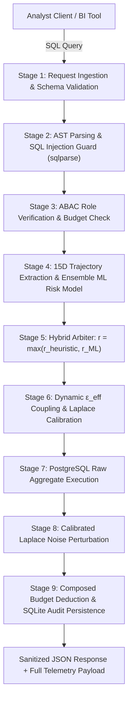

# AP3 — Adaptive Privacy-Preserving Proxy
### *Intelligent Database Proxy with Spatial-Temporal Query Trajectory ML & Closed-Loop Differential Privacy*

[](https://www.python.org/)
[](https://fastapi.tiangolo.com/)
[](https://en.wikipedia.org/wiki/Differential_privacy)
[](https://scikit-learn.org/)
[]()

---

## 📌 Executive Overview

**AP3 (Adaptive Privacy-Preserving Proxy)** is an intelligent, high-speed reverse proxy positioned between analytical SQL clients and relational databases (PostgreSQL). It prevents **inference, triangulation, differencing, and tracker attacks** by dynamically coupling live query risk to differential privacy perturbation ($\varepsilon_{\text{eff}}$), replacing vulnerable static budgets and binary rejection firewalls with an adaptive, non-leaking mathematical control loop.

### The Critical Dilemma AP3 Solves:
1. **Static Epsilon ($\varepsilon$) Vulnerability:** Existing tools (Chorus, PINQ, Diffprivlib) apply fixed privacy noise regardless of query correlation, allowing adversaries to reconstruct private records through overlapping linear queries.
2. **The "Rejection Side-Channel Oracle":** Binary security firewalls that throw `HTTP 403 / 429` when subpopulation narrowing is detected leak sensitive information. An abrupt denial acts as an oracle confirming: *"Your filter narrowed down to $\le 1$ individual."*
3. **Inability to Detect Multi-Query Attack Trajectories:** Rule-based heuristics evaluate queries in isolation or use simple hit counters. They fail against multi-query differencing probes ($Q_1$ on group $G$ vs. $Q_2$ on $G \setminus \{x\}$) and quasi-identifier tracker correlation.

---

## 🚀 Core Innovations & Highlights



1. **15-Dimensional Spatial-Temporal Trajectory Extractor:** Extracts predicate Jaccard similarity, predicate narrowing velocity ($\frac{\Delta |\text{Pred}|}{\Delta t}$), consecutive predicate overlap, symmetric difference cardinality, and exponential temporal decay ($e^{-\lambda \Delta t}$).
2. **Trained Ensemble Machine Learning Model:** A tree-based ensemble classifier & continuous regressor trained on 6,161 synthesized query instances, detecting `BENIGN`, `TRIANGULATION`, `DIFFERENCING`, and `TRACKER` attacks with **99.99% ROC-AUC** and $R^2 = 0.990$.
3. **Hybrid Mathematical Arbiter ($r_{\text{final}} = \max(r_{\text{rule}}, r_{\text{ML}})$):** Enforces an analytical privacy safety floor while incorporating pattern-based anomaly detection.
4. **Dynamic $\varepsilon_{\text{eff}}$ Coupling Loop:** Scales effective privacy budget non-linearly:
   $$\varepsilon_{\text{eff}}(u, q) = \max\left(\varepsilon_{\min}, \, \varepsilon_{\text{base}} \cdot (1 - r_{\text{final}})^\gamma\right)$$
   and adds Laplace noise calibrated to $b = \frac{\Delta f}{\varepsilon_{\text{eff}}}$.
5. **Non-Leaking Graceful Degradation:** When risk spikes or budget exhausts, queries are clamped to noise floor $\varepsilon_{\min} = 0.05$, returning heavily randomized data rather than an error code (zero binary side-channel leakage).
6. **Sub-15ms Processing Latency:** Entire proxy pipeline executes in **$\sim 13.4\text{ ms}$** on standard CPU, with the ML inference engine taking **$< 0.5\text{ ms}$**.

---

## 📂 Project Structure

```
AdaptiveP3/
├── README.md                      # Primary project overview & quickstart
├── PROJECT_DOCUMENTATION.md       # Complete architectural & ML technical deep-dive
├── Requirements.txt               # Python package dependencies
├── config.py                      # System settings (budgets, gamma, lambda decay, DB)
├── main.py                        # FastAPI application server & REST endpoints
├── query_history.db               # SQLite audit log storing AST metadata & risk scores
│
├── core/
│   ├── abac.py                    # Attribute-Based Access Control & budget state
│   ├── differential_privacy.py    # Dynamic ε coupling & Laplace noise mechanism
│   ├── inference_tracker.py       # Hybrid risk arbitration & heuristic overlap engine
│   ├── ml_risk_model.py           # Machine learning inference engine (< 0.5 ms runtime)
│   ├── query_analyzer.py          # AST parser, SQLi defense & sensitivity calculator
│   ├── swagger_theme.py           # Light-themed interactive Swagger UI customizer
│   └── trajectory_extractor.py    # 15D spatial-temporal trajectory tensor extractor
│
├── data/
│   └── query_attack_dataset.csv   # 6,161 labeled query instances for ML training
│
├── db/
│   ├── history_store.py           # SQLite audit persistence with predicate schemas
│   └── postgres.py                # PostgreSQL connection & query execution
│
├── middleware/
│   └── proxy.py                   # Unified 9-stage risk-adaptive proxy pipeline
│
├── models/
│   ├── query_risk_model.joblib    # Serialized ML ensemble bundle (classifier + regressor)
│   └── user.py                    # Pydantic schemas for users & query requests
│
├── scripts/
│   ├── eval_benchmarks.py         # Empirical benchmarks (MAE, attacks, latency)
│   ├── generate_attack_dataset.py # Synthetic session generator for ML training
│   └── train_risk_model.py        # ML ensemble training, cross-validation & metrics
│
├── tests/
│   ├── test_api_guards.py         # Injection & non-SELECT guard tests
│   └── test_ml_risk_model.py      # ML trajectory unit & integration test suite
│
└── web/
    └── index.html                 # Interactive visual playground & telemetry dashboard
```

---

## ⚡ Quick Start Guide

### 1. Environment Setup
```bash
# Clone the repository and navigate into project directory
cd AdaptiveP3

# Create and activate a virtual environment
python -m venv .venv
# Windows:
.\.venv\Scripts\activate
# Linux/macOS:
source .venv/bin/activate

# Install required dependencies
pip install -r Requirements.txt
```

### 2. Configure Database Connection (Optional)
AP3 defaults to local PostgreSQL parameters defined in `config.py`. You can override them via environment variables:
```bash
export POSTGRES_HOST=localhost
export POSTGRES_PORT=5432
export POSTGRES_DB=ap3_db
export POSTGRES_USER=ap3_user
export POSTGRES_PASSWORD=ap3_password
```

### 3. Launch the Server
```bash
uvicorn main:app --host 127.0.0.1 --port 8000 --reload
```

The application is now live:
- **Interactive Visual Playground:** [http://127.0.0.1:8000/](http://127.0.0.1:8000/)
- **Interactive Swagger API Docs:** [http://127.0.0.1:8000/docs](http://127.0.0.1:8000/docs)
- **Health Check Endpoint:** [http://127.0.0.1:8000/health](http://127.0.0.1:8000/health)

---

## 📊 REST API Reference

| Method | Endpoint | Description |
| :--- | :--- | :--- |
| `GET` | `/` | Serves the Interactive Visual Playground dashboard |
| `GET` | `/health` | Service health status and system version |
| `POST` | `/register` | Register a new user session with role budget (`admin`, `researcher`, `guest`) |
| `GET` | `/budget/{username}` | Retrieve remaining lifetime privacy budget ($\varepsilon$) |
| `GET` | `/audit/{username}` | Retrieve historical queries, predicates, risk scores, and consumed $\varepsilon_{\text{eff}}$ |
| `POST` | `/query` | **Main Proxy Endpoint:** Ingests SQL, computes risk, couples $\varepsilon_{\text{eff}}$, and returns perturbed results |

### Sample Request (`POST /query`):
```json
{
  "username": "alice_researcher",
  "sql": "SELECT AVG(salary) FROM employees WHERE department = 'Engineering'"
}
```

### Sample Response:
```json
{
  "status": "success",
  "user": {
    "username": "alice_researcher",
    "role": "researcher",
    "epsilon_remaining": 9.2069
  },
  "query_analysis": {
    "tables": ["employees"],
    "columns": ["salary", "department"],
    "predicates": ["department = 'Engineering'"],
    "aggregates": ["AVG"],
    "sensitivity": 3.75,
    "is_aggregate": true
  },
  "privacy_metrics": {
    "risk_score": 0.1095,
    "heuristic_risk": 0.0,
    "ml_risk": 0.1095,
    "attack_pattern": "BENIGN",
    "ml_confidence": 1.0,
    "top_factors": ["Query distribution within expected analytical variance"],
    "ml_latency_ms": 0.38,
    "effective_epsilon": 0.7931,
    "noise_scale": 4.7282,
    "degraded_mode": false,
    "degradation_reason": null,
    "inference_overlap_count": 0
  },
  "results": [
    { "avg": 85142.68 }
  ],
  "privacy_note": "Laplace noise applied with effective epsilon=0.7931 (noise scale b=4.7282)."
}
```

---

## 🧪 Automated Benchmarks & Model Evaluation

Run the automated evaluation suite:
```bash
python scripts/eval_benchmarks.py
```

### Empirical Results Summary:
1. **Privacy-Utility Frontier:** Empirical MAE and RMSE match theoretical Laplace standard deviation ($\sqrt{2} \cdot \frac{\Delta f}{\varepsilon}$) across all test points ($\varepsilon \in [0.1, 10.0]$).
2. **Triangulation Attack Blinding:** As adversarial probes narrow on a target record, AP3 Hybrid Risk escalates ($0.109 \to 0.920$), automatically dampening $\varepsilon_{\text{eff}}$ down to $0.05$, increasing noise variance by up to $20\times$ while avoiding side-channel rejection.
3. **Differencing Probe Interception:** Complementary query pairs targeting a single record exclusion (`id != 1002`) are immediately flagged as `DIFFERENCING` ($r_{\text{ML}} = 0.83$) with immediate noise scaling.
4. **Proxy Overhead:** Total proxy processing latency is **$13.38\text{ ms}$** (target: $< 15.0\text{ ms}$).

To retrain the ML model from scratch:
```bash
# 1. Regenerate synthetic trajectory traces
python scripts/generate_attack_dataset.py

# 2. Retrain ensemble model & update artifacts
python scripts/train_risk_model.py
```

To run automated unit & security tests:
```bash
python tests/test_api_guards.py
python tests/test_ml_risk_model.py
```

---

## 📖 In-Depth Technical Guide
For detailed mathematical formulations, machine learning architecture, feature engineering definitions, and defense scripts, refer to **[PROJECT_DOCUMENTATION.md](file:///c:/Users/aadha/Documents/VSCode/AdaptiveP3/PROJECT_DOCUMENTATION.md)**.